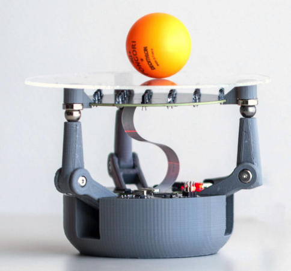

# Mastery Project

### _By:_ Vivaan Loiwal

This is the code for my project in Mastery, a class where we get to follow our passions.

## Introduction

This class begun with our teacher, Ana Paula Giorgi (AP) teaching us how real companies brainstorm ideas, such as IDEO, and the engineering process, which we'll need for our ideas. We followed this process in a fun starting project - pencilcases. Each of us interviewed one of our other classmates, and got the specifications for our pencilcases. Then, we made quick prototypes, and pitched them to the class, showing why our pencilcase turned out good, and its features.

## My Idea

This beginning process ended, and we began brainstorming. Any idea was a good idea, but we had to trim down our list to ones which were possible, not too expensive or inaccesible, and which fit our passion, and which we would be determined to finish.

## The Spark and Direction

AP called this our **SPARK**, which is our reason, and drive for doing this. After we thought about this, and came up with ideas, we filled out some worksheets for why we wanted to do this project, and what guaranteed that we would see it through. After these, and one-on-ones, we moved on to our **DIRECTION**, which is where we're going to go with our project. After this process, I decided to go along robotics, one of my largest passions, and something I would always continue.

## My Project

After some more research, I decided I was going to make a ball-balancing robot, like this robot from the Raspberry Pi Official Magazine:     
But I wanted to make everything on my own - no downloading premade CAD, or code.

## How It Works

This robot uses computer vision to track a ball on a clear plate. There is a camera mounted under the plate, and it sees the ball. Then, it calculates the angles of the arms, tilting the ball towards the target position. I would need to get all of the parts, using a Raspberry Pi, and design a PCB to connect them. Also, I would have to CAD the arms, and the joints, so I decided to use Onshape. Also, I will need to learn OpenCV, because I want to code all of this in python, the language I'm most comfortable with.

## Side Project(s)

This led me to do some side projects, to acquire the knowledge I needed. So first, I needed to learn more about PCB design, and soldering and connecting parts. So I decided to make a coin "flipping" robot, which would use a PCB, an OLED display, and a button, so when you pressed it, and picks 1 or 2, and displays "heads" or "tails" on the OLED. This was a simple, but effective project, and it taught me how to solder and combine the parts and make a real thing. But this project took a while, because it took over 2 weeks for the PCB to arrive, which I designed on [EasyEDA.com](https://easyeda.com), and ordered from [PCBWay.com](https://pcbway.com). But in that time, I decided to learn OpenCV, and with the help of Claude, created three things, which you can see in the [openCV folder](openCV), and in [ball balancer/Ball Tracker](ball%20balancer/Ball%20Tracker).

## Coin Flipper

First, I tested using a breadboard, because all of my parts arrived before the PCB, and it worked pretty well - all of the wiring and code worked. 

After the PCB finally arrived, I combined everything, and it turned out like this: 

## Final Project

This is my final project's work.

### Parts List

I used Claude to help me come up with my parts list, which filled all of my requirements. I had to cut some things which would have been nice, but were too expensive. This parts list is at [ball balancer/parts-list.md](ball%20balancer/parts-list.md), and after some iterations, I got it down to around $130, which would fit my budget. After sending this to my teacher, I found out that we had a Raspberry Pi 3B v1.2, so I'm using that, along with the SD card and power which we have.

### PCB Design

For this project, I needed a more complicated PCB, with spots for servos, a camera, and a lot of other parts, but they couldn't be connected. This meant I had to make a lot of ports for me to solder wires in. Also, my Raspberry Pi 3A+ had it's headers on top, so I had to design the PCB to go upside down, and plug into that. This PCB didn't have to be too complicated though - it only had to fit a servo controller, the Raspberry Pi, and spots for the battery to be soldered in. Also, my warm-up project's PCB didn't arrive for a while, due to a shipping error, so I switched to [JLCPCB.com](https://www.jlcpcb.com), which was cheaper, and had more delivery options.
